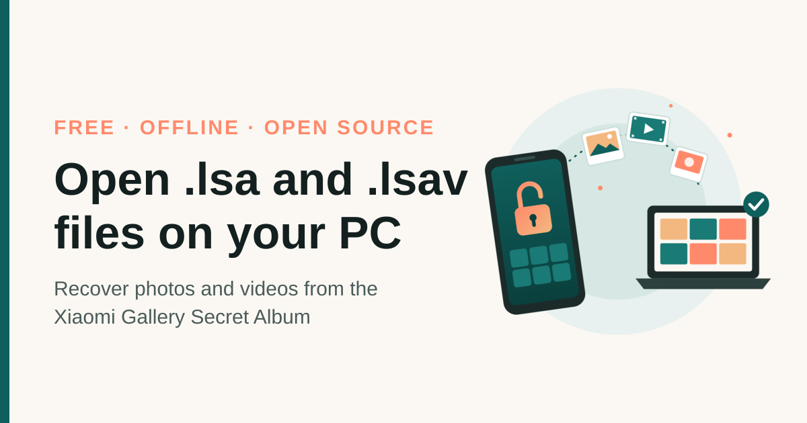

# unlsa

Turn `.lsa` and `.lsav` files from the Xiaomi / Redmi / POCO Gallery **Secret Album** back into normal photos and videos. Runs offline on Windows, macOS, and Linux.

**Website:** https://unlsav.imagineit.online/

<p align="center"></p>

## What are these files?

When you move something into the Secret Album, the MIUI / HyperOS Gallery app encrypts it and renames it:

| Extension | Original | What's encrypted |
|-----------|----------|------------------|
| `.lsa`    | Photo (JPG, PNG, HEIC, ...) | The whole file |
| `.lsav`   | Video (MP4) | Only the first 1024 bytes (the container header) |

The encryption is AES-128-CTR. The key comes from the Gallery app's signing certificate, not from your PIN, so it's the same on every phone. The middle part of each file name (for example `3e751332435bfad27569ca4efed1b602`) is the MD5 of that key.

## Requirements

- Python 3.8 or newer
- The `openssl` command (preinstalled on macOS and most Linux distributions)

On Windows:

```powershell
winget install Python.Python.3.12
winget install ShiningLight.OpenSSL.Light
```

No Python packages are needed.

## Usage

1. Copy the Secret Album folder from your phone to your computer. It's usually at `MIUI/Gallery/cloud/secretAlbum`.
2. Run:

```bash
python3 unlsa.py path/to/secretAlbum
```

Decrypted files are written to `path/to/secretAlbum_decrypted`. To pick the output folder yourself:

```bash
python3 unlsa.py path/to/secretAlbum path/to/output
```

On Windows, use `py` instead of `python3`.

The original files are never modified. Each output file gets its extension from its real content (`.jpg`, `.png`, `.heic`, `.gif`, `.webp`, `.mp4`).

### Skipped files

A file is skipped when the decrypted result isn't a recognizable photo or video. This usually means it was encrypted with a different key: check whether the hash in the file name is `3e751332435bfad27569ca4efed1b602`. Please open an issue with the hash (not the file) if you hit a different one.

## Test

```bash
python3 test_unlsa.py
```

This encrypts fake files the same way the phone does, runs `unlsa.py`, and checks that the output matches byte for byte.

## Disclaimer

For recovering your own files. This project isn't affiliated with Xiaomi. It doesn't crack any password; it does the same decryption the Gallery app does when you open the album.

## Credits

The key and IV were first published in [miui-cloud-decryptor](https://github.com/ObikBobik/miui-cloud-decryptor). Background on the format: [Decrypting MIUI Cloud files](https://blog.denniskabui.com/decrypting-miui-cloud/).

## Support

If this got your photos back, you can [buy me a coffee](https://buymeacoffee.com/farzadhoseinzade) ☕ or star the repo.

## License

[MIT](LICENSE)
